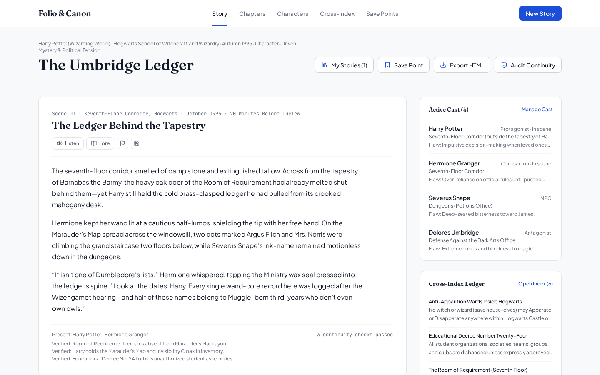
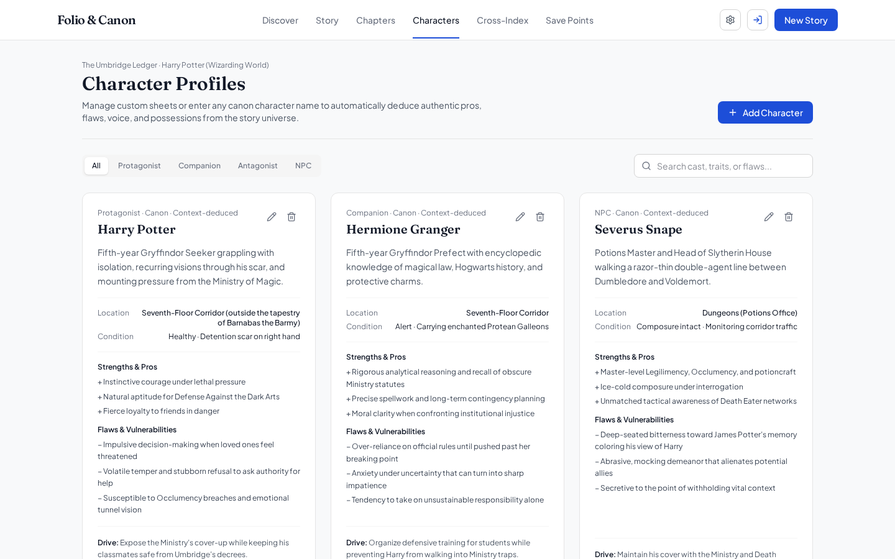

# Loreweaver (Folio & Canon)

**Folio & Canon** is a full-stack interactive storytelling studio and continuity engine for canon-aware fiction and original worldbuilding. Built with React 19, TypeScript, Vite, Tailwind CSS v4, Express, and `@google/genai`, it tracks characters, inventories, locations, timelines, and world rules across branching scenes while keeping every turn grounded in a structured **Universe Cross-Index**.

---

## Live Screenshots

### Story Workspace & Steering Deck
Interactive narrative stream with per-scene audio playback, lore inspection, manual flagging / retroactive AI rewriting, HTML export, branching choices, Dictaquill dictation, and a live contextual rail (Active Cast, Cross-Index Ledger, Save Points, and Model Configuration).



### Universe Cross-Index & Continuity Ledger
Canonical ledger tracking world rules, locations, items, plot threads, timeline events, and character facts—complete with pinning, category filters, search, and full-story continuity audits.


### Character Profiles & Canon Deduction
Structured character dossiers tracking strengths, flaws, motivations, voice/mannerisms, condition, locations, inventories, and relationships—with automatic canon deduction from just a character name and universe.



### Chapter Organization & Manuscript Assembly
Stitch individual narrative scenes ("blurbs") into numbered chapters, reorder scenes, toggle between seamless prose and prompt-annotated views, inspect chapter-level lore, synthesize chapter audio, and export standalone HTML manuscripts.


---

## Implemented Features

- **Multi-Story Library & Switcher (`App`, `NewStoryModal`, `StoryWorkspace`)**:
  - Automatically remembers every created, starter, or JSON-imported story in `localStorage` (`folio-canon-stories-v1` and `folio-canon-active-story-id-v1`, with seamless migration from single-story storage) so clicking **New Story** never overwrites prior worlds.
  - Switch between remembered stories via the **My Stories** tab inside **New Story** or the **My Stories (N)** masthead button, complete with scene/chapter/cast counts, search filtering, and two-step delete confirmation.
- **Canon-Aware Universe & Cast Builder (`NewStoryModal`)**:
  - Three curated starter worlds (with custom generated cover artwork) plus a Custom Universe Builder that deduces opening scenes, character traits/flaws, and initial Cross-Index invariants from any fictional canon or original setting.
- **Branching Narrative & Freeform Steering (`StoryWorkspace`)**:
  - Generates four context-aware narrative branches per turn or accepts multi-line freeform actions, dialogue, and plot directions.
  - Flags lore conflicts while smoothly advancing the story, updates character locations/inventories automatically, and displays continuity verification checks on each scene.
- **Universe Cross-Index & Continuity Audits (`CrossIndexView`)**:
  - Categorized ledger (`World Rules`, `Locations`, `Items`, `Plot Threads`, `Timeline`, `Character Facts`) with pinned invariants, manual editing, search, and on-demand AI continuity audits across all scenes.
- **Manual Scene Flagging & Retroactive AI Rewriting (`SceneCorrectionModal`)**:
  - Flag any scene to edit metadata/prose manually, pin a corrective rule to the Cross-Index, or instruct the model to rewrite that scene retroactively while synchronizing characters and ledger entries.
- **Scene & Chapter Item Lore Modal (`ItemLoreModal`)**:
  - Inspect the exact lore rules, items, locations, timeline anchors, and active cast states relevant to any individual scene or assembled chapter.
- **Chapter Organization & HTML / JSON Export (`ChaptersView`, `HtmlExportModal`)**:
  - Merge unassigned scenes into chapters, reorder scenes, switch between merged prose and prompt-preserving views, export single scenes/chapters or the full book as styled HTML (with optional prompt metadata), or import/export full JSON archives.
- **Save Points & Timeline Branching (`SavePointsView`)**:
  - Capture named snapshots of narrative history, characters, chapters, and Cross-Index state; restore any checkpoint or branch cleanly from an earlier scene (with automatic backup before truncating downstream turns).
- **Narrative Text-to-Speech (`TtsPlayerBar`, `useNarrativeSpeech`)**:
  - Listen to individual scenes or full merged chapters using `gemini-3.8-flash-lite-tts` with selectable voices (`Charon`, `Kore`, `Fenrir`, `Puck`, `Zephyr`), seekable playback, WAV download, and long-text audio chunk stitching.
- **Dictaquill Speech-to-Text (`DictaquillButton`)**:
  - Dictate prompts, opening premises, and scene rewrite instructions via live microphone recording (`MediaRecorder`) or audio file upload, transcribed through `gemini-3.5-transcribe` with universe/character context hints.
- **Resilient Error Handling & Prompt Retry**:
  - Defensive client JSON parsing (`postJson`), Express JSON error/404 fallbacks for `/api/*`, and one-click **Retry** controls for failed story prompts (with **Edit in Box** recovery), failed Dictaquill transcriptions (without re-recording), and failed TTS requests.

---

## Development History

| Milestone | Scope Implemented |
| --- | --- |
| **1. Core Storytelling Studio** | React + Vite + Express architecture (`server.ts`, `server/storyAgent.ts`), Starter Worlds, Custom Universe & Canon Character Deduction, Branching Narrative Workspace, Cross-Index Ledger, Continuity Audit, Save Points, and local browser persistence. |
| **2. Chapters & Manuscript Export** | Chapter Organization (`ChaptersView`) for merging/reordering scenes into cohesive chapters plus full HTML book export (`HtmlExportModal` / `htmlExport.ts`) preserving prompts and metadata. |
| **3. Scene Flagging, Retroactive Rewrites & Lore** | Added per-scene Flag controls (`SceneCorrectionModal`) with retroactive AI scene rewriting (`/api/story/rewrite-scene`), single-scene/chapter HTML source downloads, and the Item Lore modal (`ItemLoreModal`) on scenes and chapters. |
| **4. Narrative Audio (TTS)** | Integrated multi-chunk RIFF/WAV narration synthesis (`POST /api/story/tts` via `gemini-3.8-flash-lite-tts` on `v1beta`), player bar controls, voice selector, and WAV downloads on scenes and chapters. |
| **5. Dictaquill Speech-to-Text (STT)** | Added live microphone recording and audio upload transcription (`POST /api/story/transcribe` via `gemini-3.5-transcribe` on `v1beta`) inside the story composer, New Story builder, and Scene Correction modal. |
| **6. JSON Error Hardening & Prompt Retry** | Replaced brittle `res.json()` calls with `postJson`, added `/api/*` JSON error/404 Express middleware and `safeParseJson` fence/block extraction, and added retry recovery for failed story prompts, Dictaquill clips, and TTS audio. |
| **7. Multi-Story Library & Switcher** | Upgraded `localStorage` persistence to store a full multi-story library (`folio-canon-stories-v1`), added the **My Stories** switcher tab in `NewStoryModal` and masthead shortcut in `StoryWorkspace`, and preserved prior stories across **New Story** creations and JSON imports. |

---

## Tech Stack & Models

- **Frontend**: React 19, TypeScript, Vite 8, Tailwind CSS v4, `lucide-react`
- **Backend**: Node.js, Express 4, `tsx`, `@google/genai` (`^3.3.0`)
- **Configured Gemini Models**:
  - Story generation, canon deduction, audits & retroactive rewrites: `gemini-4-hydrogen` (default, configurable thinking depth `LOW` / `MEDIUM` / `HIGH` / `XHIGH`) or `gemini-3.1-flash-lite`
  - Text-to-Speech narration: `gemini-3.8-flash-lite-tts` (`v1beta`)
  - Dictaquill Speech-to-Text: `gemini-3.5-transcribe` (`v1beta`)

---

## Project Structure

```text
├── server.ts                  # Express + Vite dev/prod server & /api/story/* routes
├── server/
│   └── storyAgent.ts          # Gemini prompts, JSON schemas, TTS WAV merging, STT
├── src/
│   ├── App.tsx                # Workspace state, multi-story localStorage library, retry & story actions
│   ├── types/story.ts         # Core TypeScript models (StoryProject, StoryTurn, CrossIndexEntry, etc.)
│   ├── data/presets.ts        # Starter world templates and cover assets
│   ├── hooks/
│   │   └── useNarrativeSpeech.ts  # Audio playback state for scenes and chapters
│   ├── utils/
│   │   ├── api.ts             # Defensive JSON fetch helper (postJson)
│   │   └── htmlExport.ts      # Scene, chapter, and full-book HTML exporters
│   └── components/
│       ├── TopNav.tsx
│       ├── StoryWorkspace.tsx
│       ├── ChaptersView.tsx
│       ├── CharactersView.tsx
│       ├── CrossIndexView.tsx
│       ├── SavePointsView.tsx
│       ├── NewStoryModal.tsx
│       ├── SceneCorrectionModal.tsx
│       ├── ItemLoreModal.tsx
│       ├── HtmlExportModal.tsx
│       ├── ModelConfigPanel.tsx
│       ├── DictaquillButton.tsx
│       └── TtsPlayerBar.tsx
└── docs/
    └── screenshots/           # Live application screenshots
```

---

## Local Setup & Scripts

1. Install dependencies:
   ```bash
   npm install
   ```
2. Configure environment variables based on `.env.example`:
   ```bash
   cp .env.example .env
   ```
   Set `GEMINI_API_KEY` in `.env` (or via your runtime secrets manager).
3. Start the full-stack development server (port `3000`):
   ```bash
   npm run dev
   ```
4. Type-check or build for production:
   ```bash
   npm run lint
   npm run build
   ```
