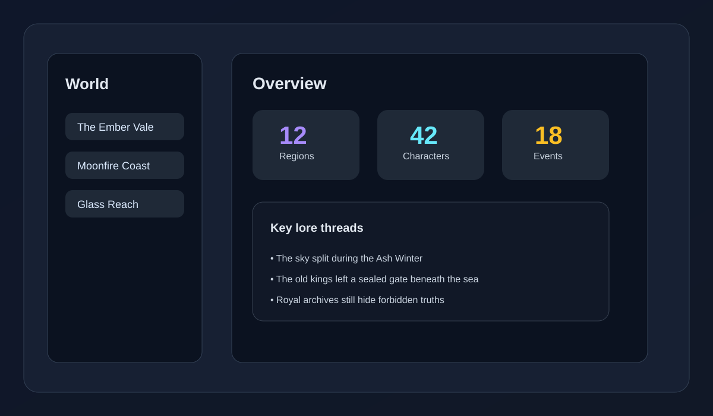
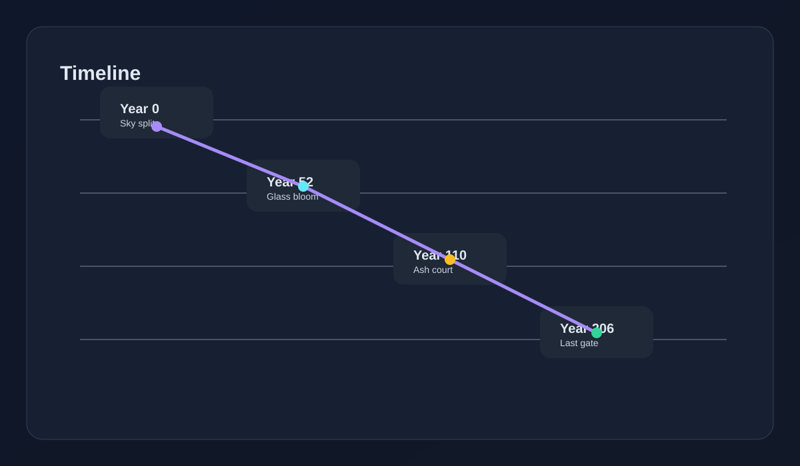

# Loreweaver

Loreweaver is a small worldbuilding and storytelling project for organizing fictional settings, characters, and timelines.

The goal is simple: keep lore easy to track as a world grows. Instead of scattered notes, Google Docs, and random sketches, Loreweaver aims to provide a single place to collect ideas and relationships.

## Current scope

This repository is currently a concept and starter project. It is not a finished app yet.

Planned areas of focus:

- world regions, cities, and landmarks
- characters and factions
- timeline and major events
- notes, rumors, and secret history
- relationship tracking between people and groups
- simple project organization for stories, campaigns, or universe design

## Why this project exists

When a world becomes large, details drift. Names change. Events overlap. The same culture becomes inconsistent across scenes or chapters.

Loreweaver is meant to help with that by keeping a structured record of:

- where things are
- who matters
- what happened
- why it matters

## Example concept mockups

These are illustrative visual ideas for the project, not polished screenshots of a finished product.

## Possible directions

This project could become any of the following:

- a local-first worldbuilding app
- a browser-based dashboard for story projects
- a companion tool for writers and game designers
- a collaborative lore database

## Project status

This is an early-stage concept repository.

At this stage, the project should be treated as a design direction and proof of concept, not a complete release.

## Next steps

A realistic next milestone would be to define:

- the data model for worlds, characters, and events
- a minimal UI for browsing and editing entries
- a way to store notes and relationships
- a simple export flow for markdown or JSON

## License

No license has been added yet. If this project is shared publicly, consider adding one before distributing it beyond personal use.
