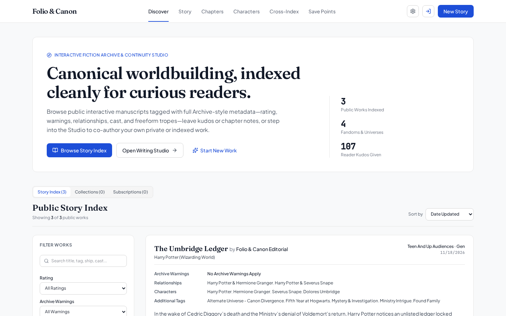
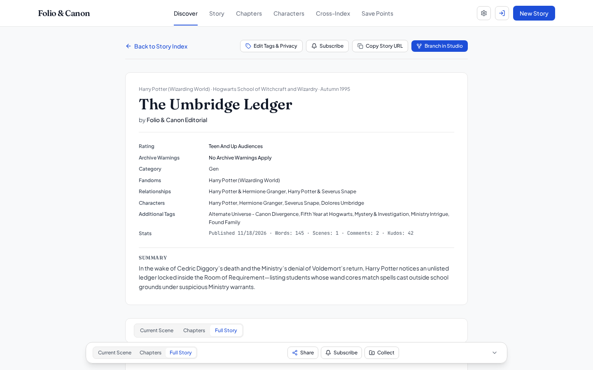
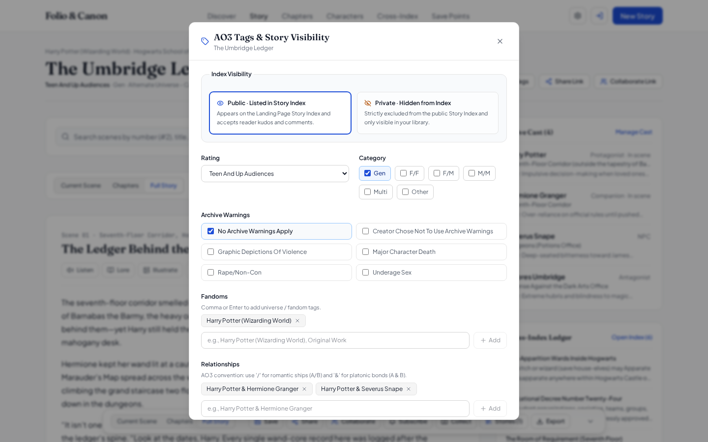
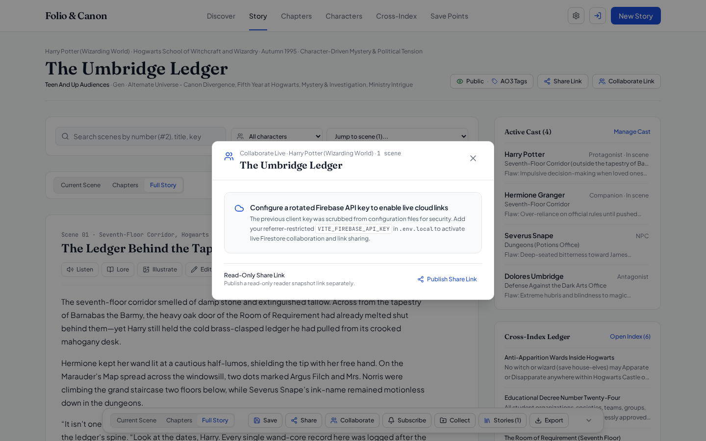
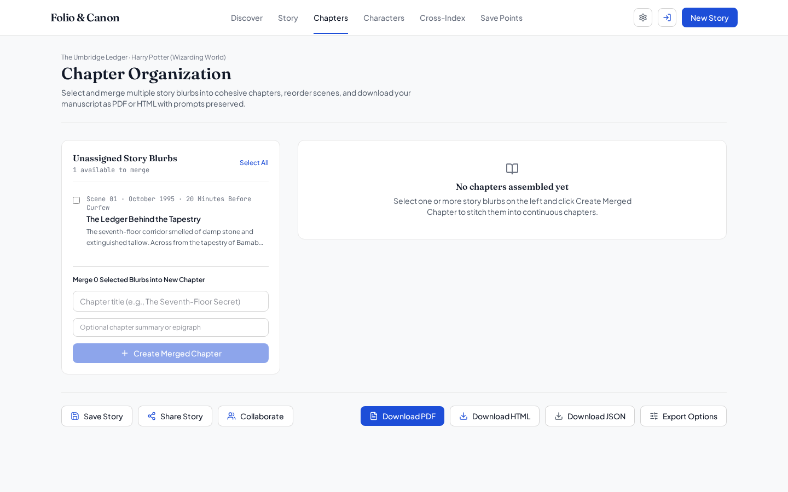
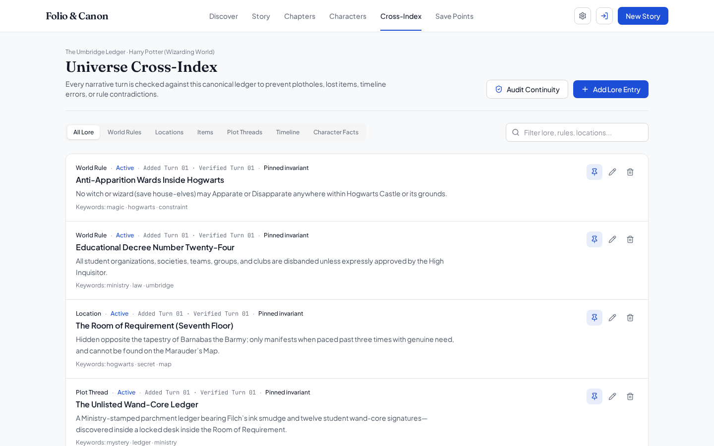
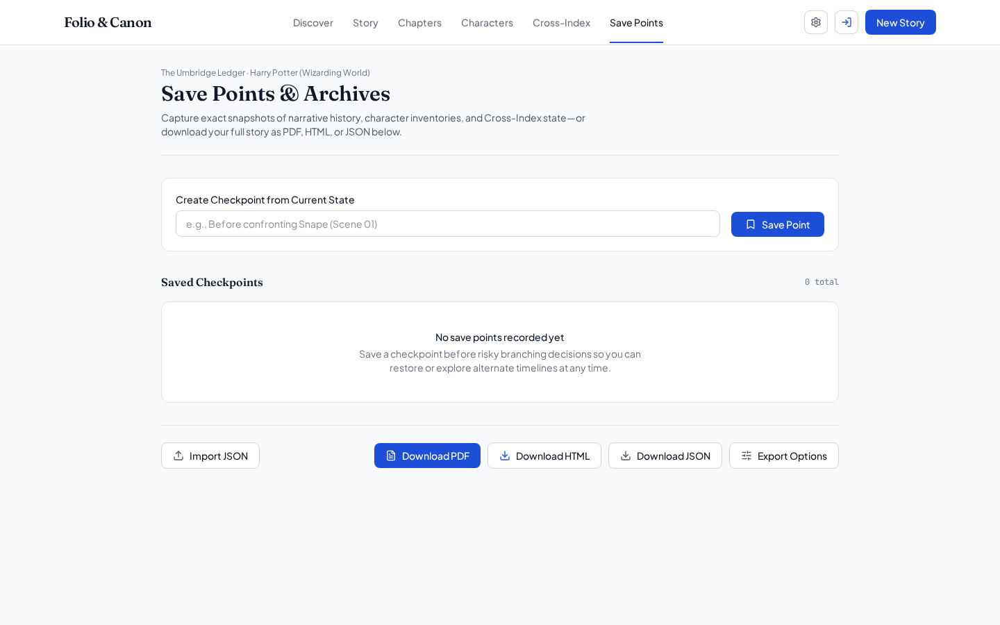
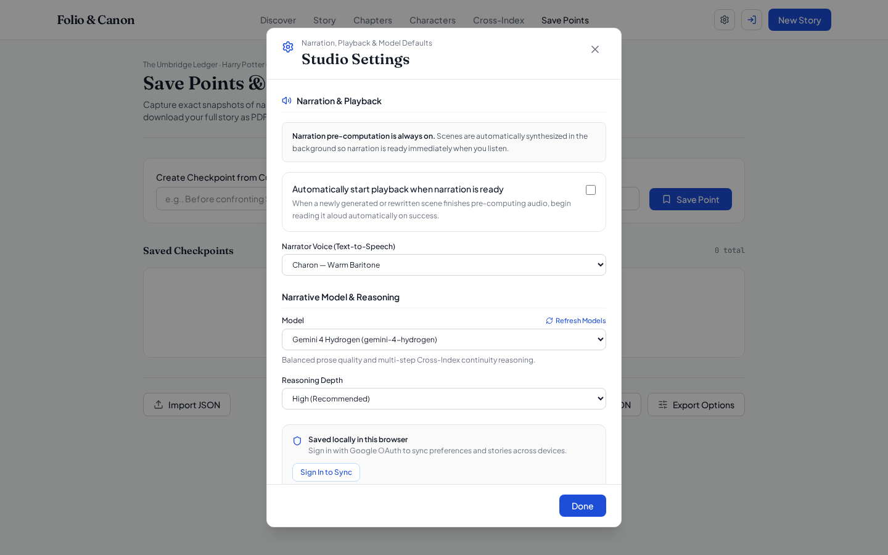

# Folio & Canon

**Folio & Canon** is a full-stack interactive storytelling studio, continuity ledger, and real-time collaborative writing platform for canon-aware fiction and original worldbuilding. Built with React 19, TypeScript, Vite 8, Tailwind CSS v4, Express, WebSockets (`ws`), Firebase Auth/Firestore, and `@google/genai`, it tracks characters, inventories, locations, timelines, and canonical rules across branching scenes.

---

## Visual Tour (Auto-Captured Screenshots)

All screenshots below are automatically captured from the live application using Playwright (`npm run docs:update`).

### 1. Landing Page, Story Index, Collections & Subscriptions
Editorial landing experience showcasing public works indexed with AO3-style metadata (`Rating`, `Archive Warnings`, `Category`, `Fandoms`, `Relationships`, `Characters`, and `Additional Tags`), instant multi-facet filtering, sorting, strict exclusion of any manuscript marked `isPrivate: true`, and dedicated **Collections** and **Subscriptions** shelves.



### 2. Public Story Reader, View Modes, Comments & Anonymous Kudos
Full work view (`/?story=<publicId>`) with the complete AO3 metadata grid, a 3-way **Current Scene | Chapters | Full Story** display toggle, hovering storywide menu overlay, one-per-user/anonymous **Give Kudos ♥** action with live counter, and hierarchical scene → chapter → story comments & replies.



### 3. Story Workspace, Hovering Menu Bar & Two-Link Masthead
Interactive narrative stream featuring **Current Scene / Chapters / Full Story** view switching, live scene search and character filtering (`#turn`, title, keyword, or cast member), hovering translucent **StoryFloatingBar** overlay (quick Save, Share, Collaborate, Subscribe, Collect, Stories, and PDF/HTML/JSON exports), AO3 Tags & Visibility controls, per-scene pre-computed TTS narration, scene illustrations, manual flagging & retroactive AI rewrites, branching choices, Dictaquill voice dictation, and explicit **Share Link** and **Collaborate Link** controls for every story.


### 4. AO3 Tag Taxonomy & Public/Private Visibility Modal
Authors can toggle any story between **Public (Listed in Story Index)** and **Private (Excluded from Index)** and manage Rating, Archive Warnings, Categories, Fandoms, Relationships (`/` and `&`), Cast-synced Characters, and Additional Tags.



### 5. Two Links per Story: Public Share & Live Collaboration
Every manuscript maintains two dedicated links synchronized across the masthead, hovering overlay bar, and **My Stories** library:
- **Share Link (`/?share=<shareId>`)**: Publishes a read-only reader snapshot (`/sharedWorks/{shareId}`) for sharing full stories, single chapters, or individual scenes without exposing private user data.
- **Collaborate Link (`/?collab=<collabId>`)**: Opens a live co-authoring room (`/collaborations/{collabId}` + `/ws/collab` WebSocket presence) so multiple signed-in writers can advance scenes, edit prose, organize chapters, and watch collaborator activity live.



### 6. Chapter Organization & Manuscript Assembly
Assemble unassigned story blurbs into numbered chapters, reorder scenes, toggle between merged reading flow and prompt-preserving studio mode, generate chapter illustrations or audio narration, export PDF/HTML chapters, and publish chapter-level Share Links.



### 7. Character Profiles & Canon Deduction
Structured dossiers tracking strengths, flaws, motivations, vocal mannerisms, injuries/status, locations, inventories, and relationships—plus instant canon profile deduction from a character name and universe.


### 8. Universe Cross-Index & Continuity Audits
Categorized canon ledger (`World Rules`, `Locations`, `Items`, `Plot Threads`, `Timeline`, `Character Facts`) with pinned invariants, manual CRUD, filtering, and full-manuscript AI continuity audits.



### 9. Save Points, Exports & Archive Recovery
Capture named snapshots of turns, cast, chapters, and Cross-Index state; restore any checkpoint; or download the full book as formatted PDF, styled HTML, or portable JSON archive.



### 10. Studio Settings & Custom Account Handle
Centralized Studio Settings behind the gear icon for narrative Gemini model selection, reasoning thinking level, Text-to-Speech narrator voice, and automatic playback on ready—paired with a compact icon-only Account button for freely chooseable author/reader usernames and Google OAuth cloud sync.



---

## Core Functionality

- **Landing Page & Public Story Index with Private Story Exclusion**:
  - Default entry view showcases indexed public stories while strictly excluding any manuscript with `isPrivate: true` at both the UI query/filter layer (`filterPublicStories`, `buildMergedPublicStoryIndex`) and Firestore security rules (`/publicStories/{publicId}`).
- **3-Way Display Toggle & Hovering Overlay Menu (`StoryFloatingBar`)**:
  - Switch seamlessly between **Current Scene**, **Chapters**, and **Full Story** in both the Reader and Studio Workspace, supported by a collapsible translucent floating action bar.
- **Freely Chooseable Account Username & Icon-Only Account Button**:
  - Customize a public pen name / reader handle whether browsing locally or synced to Firestore via Google OAuth, accessed via a clean icon-only button in `TopNav`.
- **AO3-Style Tagging Taxonomy (`ao3Tags.ts`, `StoryTagsModal`)**:
  - Full structured metadata supporting `Rating`, `Archive Warnings`, `Categories`, `Fandoms`, `Relationships` (`/` romantic and `&` platonic conventions), `Characters` (with one-click cast sync), and `Additional Tags`.
- **Hierarchical Comments & Anonymous Kudos (`CommentsSection`, `commentsTree.ts`, `communityStore.ts`)**:
  - Both signed-in readers (optional anonymity) and guests (persistent browser `anon_*` token) can award permanent deduplicated kudos (`/publicStories/{publicId}/kudos/{kudoId}`).
  - Threaded comments and sub-comments anchor to `story`, `chapter`, or `scene`: scene comments roll up into chapters, and chapter + scene comments roll up into the full story view.
- **Collections & Story Subscriptions (`LibraryShelfView`)**:
  - Create public or private named collections, add or remove stories from index cards or the hovering bar, and subscribe to public stories to track newly added scenes/chapters—synced to `/users/{uid}/collections` and `/users/{uid}/subscriptions`.
- **Dual Per-Story Links (Share vs. Collaborate)**:
  - **Read-Only Share Link (`/?share=<shareId>`)**: Share full manuscripts, individual chapters, or single scenes via `ShareModal` and `SharedWorkView`, backed by `/sharedWorks/{shareId}`. Readers can inspect prose and cast read-only or fork/import a local copy.
  - **Real-Time Collaboration Link (`/?collab=<collabId>`)**: Invite verified co-authors via `CollaborationModal` into a synchronized room backed by Firestore (`/collaborations/{collabId}` + `/collaborations/{collabId}/members/{uid}`) and a low-latency WebSocket presence hub (`/ws/collab`).
- **Turn Search & Instant Jump (`StoryTurnSearchBar`)**:
  - Filter scenes by scene number (`#2`, `scene 02`, `2`), scene/chapter title, keyword, or character dropdown, highlight matches inline, and jump straight to any scene card.
- **Persistent Multi-Story Library & Cloud Sync (`AuthContext`, `cloudSanitize`)**:
  - Works offline-first via `localStorage` (`folio-canon-stories-v1`) and automatically synchronizes user settings and stories to Firestore on Google OAuth sign-in, while safely stripping inline base64 images so Firestore document limits are respected.
- **Pre-Computed Narrative Audio & Auto-Play (`useNarrativeSpeech`, `TtsPlayerBar`)**:
  - Background pre-computation of scene narration via `gemini-3.8-flash-lite-tts` with configurable voices (`Charon`, `Kore`, `Fenrir`, `Puck`, `Zephyr`), seekable timeline, optional auto-play on readiness, and WAV download.
- **Dictaquill Speech-to-Text (`DictaquillButton`)**:
  - Record voice direction via `MediaRecorder` or upload audio clips transcribed through `gemini-3.5-transcribe` with universe and cast context hints.
- **Rich Manuscript Exports (`pdfExport`, `htmlExport`, `HtmlExportModal`)**:
  - Export standalone formatted PDF documents (`jspdf`), styled responsive HTML manuscripts (with toggleable prompts, choices, continuity notes, and lore appendix), or JSON archives for single scenes, chapters, or full books.

---

## Security & Secret Hygiene

- **Zero Tracked API Keys**: Client Firebase settings are loaded via Vite environment variables (`VITE_FIREBASE_API_KEY`, `VITE_FIREBASE_PROJECT_ID`, `VITE_FIREBASE_APP_ID`, etc.) in `src/firebase.ts` with graceful fallback to unconfigured/local-first mode when credentials are absent or rotated.
- **Gitignore Protection**: `.env*` (except `.env.example`) and `firebase-applet-config.json` are excluded via `.gitignore`; only safe template placeholders (`.env.example`, `firebase-applet-config.example.json`) belong in version control.
- **Google Cloud API Key Restrictions**: Browser Firebase Web API keys should always be restricted by **HTTP referrers** and limited solely to Firebase Authentication (`Identity Toolkit API`) and `Cloud Firestore API`—never unrestricted and never granted access to `Generative Language API` (which remains strictly server-side in `server/storyAgent.ts` via `process.env.GEMINI_API_KEY`).
- **Firestore Security Rules (`firestore.rules`)**: Enforces default deny-all, `email_verified == true`, strict schema allowlists (`hasAll` / `hasOnly`), immutable ownership keys, server timestamp checks, and collaborator membership enforcement.
- **Automated Build Gate**: `tests/unit/securityHygiene.test.ts` runs on every `npm test` / `npm run build` to fail immediately if any `AIza...` key pattern ever appears in tracked files.

---

## Automated Unit & Integration Test Suite

`npm run build` runs the full **Vitest** suite automatically before bundling (`npm test && vite build`).

Latest verified run via `npm run docs:update`: **24/24 test files passed (39/39 tests passed)**.

| Test File | Tests | Status |
| --- | ---: | --- |
| `tests/integration/collab.ws.test.ts` | 1 | Passed |
| `tests/integration/community.ui.test.tsx` | 4 | Passed |
| `tests/integration/firestore.rules.test.ts` | 4 | Passed |
| `tests/integration/server.api.test.ts` | 4 | Passed |
| `tests/integration/ui.components.test.tsx` | 2 | Passed |
| `tests/unit/ao3Tags.test.ts` | 6 | Passed |
| `tests/unit/cloudSanitize.test.ts` | 3 | Passed |
| `tests/unit/commentsTree.test.ts` | 3 | Passed |
| `tests/unit/htmlExport.test.ts` | 3 | Passed |
| `tests/unit/securityHygiene.test.ts` | 2 | Passed |
| `tests/unit/storyLinks.test.ts` | 3 | Passed |
| `tests/unit/turnSearch.test.ts` | 4 | Passed |

---

## Backend API & WebSocket Endpoints

- `GET /api/health` — Server liveness check (`{ ok: true }`).
- `GET /api/config` & `GET /api/models` — Available Gemini narrative models and server key readiness boolean (never exposes raw secrets).
- `POST /api/story/deduce-universe` — Generates opening world, cast dossiers, and initial Cross-Index ledger.
- `POST /api/story/deduce-character` — Canon-aware profile synthesis for a single character.
- `POST /api/story/advance` — Generates next narrative scene, state updates, and branching choices.
- `POST /api/story/rewrite-scene` — Retroactively rewrites a flagged scene while keeping continuity synchronized.
- `POST /api/story/audit` — Full-story continuity check across turns, cast, and Cross-Index ledger.
- `POST /api/story/illustrate` — Scene and chapter illustration generation.
- `POST /api/story/tts` — Multi-chunk WAV narrative audio synthesis.
- `POST /api/story/transcribe` — Dictaquill audio-to-text transcription.
- `WS /ws/collab` — Real-time room presence (`room:presence`), collaborator activity pings (`room:activity`), and sync notifications (`room:sync`).

---

## Tech Stack

- **Frontend**: React 19, TypeScript, Vite 8, Tailwind CSS v4, `lucide-react`, `jspdf`
- **Backend**: Node.js, Express 4, `ws`, `tsx`, `@google/genai`
- **Auth & Persistence**: Firebase Authentication (Google OAuth) & Cloud Firestore
- **Testing & Docs Automation**: Vitest 5, Testing Library (`@testing-library/react`, `@testing-library/jest-dom`), `jsdom`, Playwright (`playwright-core`)

---

## Project Structure

```text
├── server.ts                            # HTTP server entry point (Express + WS collab hub + Vite/static)
├── server/
│   ├── apiApp.ts                        # Modular Express API router & JSON error middleware
│   ├── collabHub.ts                     # Real-time WebSocket collaboration hub (/ws/collab)
│   └── storyAgent.ts                    # Gemini generation, audits, rewrites, WAV TTS, STT
├── src/
│   ├── App.tsx                          # Studio orchestrator, multi-story state, Share & Collab routes
│   ├── firebase.ts                      # Env-driven Firebase initialization with safe local fallback
│   ├── contexts/AuthContext.tsx         # Google OAuth, cloud sync, SharedWork & Collaboration CRUD
│   ├── hooks/
│   │   ├── useCollabRoom.ts             # WebSocket live participant presence & activity hook
│   │   └── useNarrativeSpeech.ts        # Pre-computed scene/chapter narration & auto-play hook
│   ├── utils/
│   │   ├── cloudSanitize.ts             # Firestore undefined/image stripping helpers
│   │   ├── htmlExport.ts                # Scene, chapter, and full-book HTML exporters
│   │   ├── pdfExport.ts                 # Scene, chapter, and full-book PDF generators
│   │   ├── storyLinks.ts                # Canonical ?share= and ?collab= URL builders/parsers
│   │   └── turnSearch.ts                # Turn number, keyword, title, and character search matcher
│   └── components/                      # Workspace views, search bar, settings, Share & Collaboration modals
├── tests/
│   ├── unit/                            # Pure logic & security hygiene unit tests
│   └── integration/                     # HTTP API, WS hub, Firestore rules, and React UI integration tests
├── scripts/
│   └── update-readme.ts                 # Automated Playwright screenshot capture & README generator
└── docs/
    └── screenshots/                     # Auto-generated application screenshots
```

---

## Local Setup & Scripts

1. **Install dependencies**:
   ```bash
   npm install
   ```
2. **Configure environment variables**:
   ```bash
   cp .env.example .env.local
   ```
   Provide your server-side `GEMINI_API_KEY` plus your referrer-restricted Firebase Web SDK `VITE_FIREBASE_*` variables.
3. **Run development server** (port `3000`):
   ```bash
   npm run dev
   ```
4. **Run unit & integration tests**:
   ```bash
   npm test
   ```
5. **Type-check, test, and build for production**:
   ```bash
   npm run lint
   npm run build
   ```
6. **Capture fresh Playwright screenshots and regenerate `README.md`**:
   ```bash
   npm run docs:update
   ```
